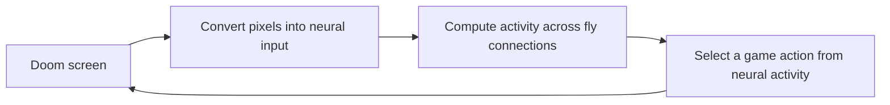

# Fly Doom

A research project to train a model based on the real fruit fly connectome to control Doom.

**Status: the integrated visual-control research desk is working end to end.** The retained Laya Vision model, real anatomical map, trained visual circuit, eight-action research decoder, recorded reward feedback and recorded-decision inspection now share one workspace. This is a completed software integration, not a claim of biological validation or strong Doom performance.

## Laya teaches; the brain plays through its own eye

**Latest expanded experiment (October 13):** teacher rehearsal now covers all 833 stored TRAIN frames from 32 episodes. Eight reward-learning batches used 32 new games per learner; successful training trajectories constrain forgetting. The joint candidate hit **20/32 (62.5%)** on fresh matched final starts, versus **14/32 (43.75%)** for the retained parent, **15/32** for decoder-only learning and **10/32** with transmission disconnected. It gained nine parent failures but lost three parent successes and failed the preliminary gate, so it remains an inspectable research candidate. The preferred model was retained. Different experiments use different starts; their percentages are not a learning curve.

```powershell
# Continue the expanded finite training protocol:
.\.venv\Scripts\python.exe -m flydoom.expanded_learning
# Inspect the completed expanded candidate without retraining:
.\.venv\Scripts\python.exe -m flydoom --learning-candidate
# Play the model retained by acceptance checks:
.\.venv\Scripts\python.exe -m flydoom --self-trained
```

Run and Restart keep weights frozen. The desk also displays completed topology/transfer audits and independent calcium-response measurements, with their checkpoint provenance and biological limitations. Rehearsal labels were reused from existing verified Laya data; no teacher runs during play. [Expanded protocol and results](docs/RESEARCH.md#expanded-retention-topology-and-independent-physiology-october-13-2026).

**Corrected reward learning now has a finite automatic cycle.** It collects its own game experience, updates shared anatomical relay gains and the action readout using game rewards, compares four frozen policies, and retains the preferred model unless both acceptance stages pass. Laya supplies stored TRAIN rehearsal targets, never live actions. Continuing research weights and preferred playback weights have separate verified pointers.

```powershell
# Train two bounded cycles; no browser opens during training:
.\.venv\Scripts\python.exe -m flydoom.self_learning --cycles 2
# Play the preferred model after completed acceptance checks:
.\.venv\Scripts\python.exe -m flydoom --self-trained
# Inspect the latest candidate and its reward-credit records, even if rejected:
.\.venv\Scripts\python.exe -m flydoom --learning-candidate
```

Defaults are two batches of two training episodes per learner per cycle, plus eight gate and 32 final games for each of four conditions. `--cycles`, `--batches`, `--episodes-per-batch` and `--test-episodes` set finite budgets. Another training invocation continues the saved research cursor; Run and Restart only play frozen weights. A rejected candidate remains available for research without replacing the preferred model. This implements an experimental self-improvement mechanism; successful weight updates alone do not prove improved play. [Protocol and limits](docs/RESEARCH.md#corrected-reward-learning-and-guarded-cycles-october-13-2026).

**Completed two-cycle pilot (October 13): both candidates failed full acceptance, so the corrected parent remains preferred.** On the latest 32 matched starts, joint learning hit **21/32 (65.625%)**, the retained parent **20/32 (62.5%)**, decoder-only learning **18/32 (56.25%)**, and disconnected transmission **11/32 (34.375%)**. The joint model gained four parent failures but lost three parent successes. Its gate visual margin, required two extra final hits and retention limit did not all pass. The preceding cycle scored 19/32 versus its parent's 18/32 on different starts; these two percentages are not a before/after comparison. Each cycle changed 98,141 existing edge values through 173 shared gain parameters and updated the readout. The entire pilot added only eight training episodes / 316 decisions per learner, with 69 rehearsal frames from one complete stored Laya TRAIN episode; this is not full training or broad teaching coverage. All 320 frozen gate/final games completed. Verification includes 380 software tests, 206 exact native training-decision replays, frozen live/restart checks and real browser checks. No caches or previous models were removed.

**Arithmetic experiment (October 12): a neural arithmetic defect was corrected, but target-hit performance did not improve.** Tiny evoked signals were lost by float32 baseline addition/subtraction. The equivalent stable calculation reduced descending-state error against a float64 reference about 13,500-fold on 100 TRAIN frames. After replaying 833 verified Laya TRAIN images and fitting the action readout, fresh matched final results were **22/32 old sampled parent, 22/32 corrected candidate, 16/32 corrected candidate with transmission disconnected**. Mean returns were -102.47, -98.66 and -138.69. The candidate gained two starts and lost two. Its visual-control margin passed, but the required extra hits versus parent did not; neither the preferred fallback nor the default controller was replaced. This corrects simulated transmission, not biological validity or all gameplay failures.

Open the completed corrected experiment without retraining:

```powershell
.\.venv\Scripts\python.exe -m flydoom --precision-student
```

Use Run, Pause, Single step and Restart episode. **Training evidence** shows the numerical audit, development choice and all three final conditions. Laya remains an offline teacher; live decisions use the eye-driven neural circuit and a frozen sampled readout. This flag explicitly opens the experiment even though game acceptance failed. Old checkpoints retain their original arithmetic; corrected checkpoints use a separate schema and reject legacy training loaders. [Protocol, limits and verification](docs/RESEARCH.md#correcting-small-signal-neural-arithmetic-october-12-2026).

To repeat the bounded offline experiment, use `python -m flydoom.precision_training`. It reuses stored Laya labels and reserves fresh starts; it does not resume a live episode or run automatic online reinforcement learning. Earlier checkpoints and caches are preserved.

Failure diagnosis and corrective teaching are available in separate tools:

**Previous deployment comparison (different starts):** on the same 32 reserved starts, the retained greedy brain hit 13 targets (40.6%), its unchanged learned policy with categorical sampling hit 17 (53.1%), and the same sampler with visual input disconnected hit 14 (43.8%). Sampling gained seven successes and lost three. It failed the predeclared retention and visual-control margins; no preferred/default model was replaced. This is a deployment experiment, not new successful weight training. The three balanced readout fits below were also rejected on development gameplay.

To explicitly inspect the sampled experiment with frozen weights:

```powershell
.\.venv\Scripts\python.exe -m flydoom --checkpoint runs/sampling-evaluation-v1
```

`--sampled-student` follows the acceptance result and currently retains the parent; its desk explains the fallback and shows the full comparison. [Protocol, limits and verification](docs/RESEARCH.md#deploying-the-stochastic-reward-trained-policy-october-11-2026).

The follow-up balanced protocol reuses all 833 verified TRAIN frames, rehearses prior behavior and selects by development gameplay with explicit retention checks. Its play command loads an accepted correction or automatically retains the parent if acceptance fails:

```powershell
.\.venv\Scripts\python.exe -m flydoom.recovery_training_v2
.\.venv\Scripts\python.exe -m flydoom --balanced-student
```

The second command only plays saved weights; it does not retrain. [Protocol and measured results](docs/RESEARCH.md#balanced-correction-with-parent-retention-october-11-2026).

**The first correction did not improve gameplay.** On 24 matched fresh starts, the unchanged parent hit 11 targets (45.8%), while both corrected variants hit four (16.7%). No default was replaced. Validation teacher agreement increased to 73.25%, but a TRAIN-chosen constant RIGHT prediction scores 81.53% on the imbalanced validation labels. `--recovery-student` explicitly opens that failed-gate experiment for inspection, not an improved recommended controller. See [the failure analysis and complete outcome](docs/RESEARCH.md#failure-diagnosis-and-student-visited-correction-october-11-2026).

```powershell
# Diagnose retired test games, including same-image Laya comparisons:
.\.venv\Scripts\python.exe -m flydoom.failure_audit --output runs/my-failure-audit
# Inspect target-patch sensitivity from that audit without invoking Laya again:
.\.venv\Scripts\python.exe -m flydoom.failure_audit --output runs/my-failure-audit --occlusion
# Correct a specific learned parent using fresh student-controlled trajectories:
.\.venv\Scripts\python.exe -m flydoom.recovery_training --parent runs/reward-student/cycle-20261011-050208-412071
# Play the latest completed corrective-teaching experiment, with weights frozen:
.\.venv\Scripts\python.exe -m flydoom --recovery-student
```

The diagnostic found repeated left/right reversals in failed games and a teaching-coverage gap: all 334 original Laya TRAIN frames came from the first 24 decisions. Correction records complete student-controlled episodes up to the standard 75-decision cap, labels them with Laya offline and retains original TRAIN examples. It trains both shared anatomical relay gains and the readout, with a fixed-relay control and unchanged-parent benchmark. Engine annotations are diagnostic-only; they do not supply correction targets or deployed actions. The correction registry is separate from the reward-training registry, and old models/caches remain intact. This is a bounded DAgger-style correction pass, not a claim that the failure is solved before its independent tests. [Diagnosis and protocol](docs/RESEARCH.md#failure-diagnosis-and-student-visited-correction-october-11-2026).

To **play the already trained model**, run `python -m flydoom --reward-student`. Run and Restart do not train. A target hit ends the single-target scenario immediately, even before the time or decision cap. These are per-episode limits, not a limit on the whole training experiment. Offline training automatically advances through its episode budget.

To **continue learned weights**, use the versioned continuation trainer:

```powershell
.\.venv\Scripts\python.exe -m flydoom.reward_training_v3
```

V3 starts from the latest verified reward checkpoint (or the Laya student if no reward checkpoint exists), retaining its neural graph, decoder and, when available, learned value baseline. It rebuilds original Laya TRAIN rehearsal drives against that continued graph. This is a warm start with fresh rollout randomness and a new relative trust anchor, not an exact resume of an interrupted optimizer process. Existing sources/checkpoints/caches are retained. The original v2 command below still starts a separate experiment from the Laya student.

Training defaults to 150 decisions and 600 engine tics **per episode**, with eight antithetic relay-gradient directions instead of four. Target elimination still ends an episode early. Both learning policies receive the same budgets and start from the same continued parent. Frozen gate/final tests retain the original 75-decision / 300-tic limits and compare against that unchanged parent, so extra training time cannot inflate the reported test success rate. Longer-episode training returns are not directly comparable to earlier shorter-episode returns. These changes are hypotheses to evaluate, not a guarantee of better play. Flags `--training-decisions`, `--training-tics`, `--relay-directions`, `--batches`, `--episodes-per-batch` and `--test-episodes` make the bounded protocol explicit. Preparation progress identifies each reserved opening. No browser opens during training; use a second terminal for the live desk.

The completed continuation pilot (`runs/reward-student/cycle-20261011-053524-608348`) added eight training episodes per learner in two batches. On the same sixteen fresh final episodes, joint continuation hit **10/16 (62.5%)**, while its unchanged parent and decoder-only continuation each hit **11/16 (68.75%)**. Mean returns were -97.625, -111.4375 and -75.125, respectively. The joint policy passed neither the 80% gate nor demonstrated a hit-rate improvement; it remains an experimental candidate. The earlier 4/8 result used different games and must not be read as a before/after improvement to 10/16. Verification: 363 software tests, 32 exact recorded training-decision replays, eight exact live-decision replays with teacher construction forbidden, and a real browser check including saved-credit inspection and a 390-pixel viewport. No caches or earlier checkpoints were removed.

The next stage, **Laya initialization followed by game-reward learning**, is available as a bounded experiment:

```powershell
.\.venv\Scripts\python.exe -m flydoom.reward_training_v2
# After the experiment finishes, inspect the resulting experimental brain:
.\.venv\Scripts\python.exe -m flydoom --reward-student
```

The default experiment runs eight batches of four training episodes for each of two policies: joint relay/readout reinforcement learning and a decoder-only control. Both start from the same verified Laya student. Actions are sampled from each current neural policy during training. Actual scenario rewards supply discounted reward-to-go (`gamma=0.99`, reward scale `1/100`), so a later hit can credit earlier aiming decisions. A learned linear value baseline uses only descending-cell features. The decoder uses analytic policy gradients; relay gains use four random-direction finite-difference estimates of the same causal policy objective. This is an engineering learning rule, not a validated model of fly dopamine or synaptic plasticity.

Retained **training-only** Laya targets are rehearsed, with bounded policy drift and teacher-loss checks to limit forgetting. These constraints are checked on training data; they do not guarantee preserved performance on unseen games. Anatomy, connection signs, visual rows and time constants remain fixed. Updates occur between batches; weights are fixed within each episode. Native images still reach the policy only through the eye and anatomical neural circuit. No teacher inference occurs in reward training or student evaluation.

Each policy receives the same reserved training openings and budget. The unchanged Laya student, joint learner and decoder-only learner are then compared on eight gate episodes and 24 separate final episodes each. The final tests never select parameters; no candidate automatically replaces the approved controller. `--batches`, `--episodes-per-batch` and `--test-episodes` set explicit budgets. Repeating the command starts a fresh experiment from the selected Laya parent; it does not resume optimizer state or learn indefinitely in the background.

In the desk, **Run** and **Restart** test the selected frozen checkpoint. **Training evidence** shows the measured batch changes, comparisons and retained per-decision reward credit. The credit viewer explicitly separates historical training from the current live game. Its future returns and value predictions use scaled rewards. The legacy paired-relay controls are hidden and disabled for this checkpoint; they remain available in the earlier adaptive and Laya-only modes.

The corrected pilot, `runs/reward-student/cycle-20261011-050208-412071`, used four batches of four episodes per learner and 83 retained teacher frames. All four joint updates passed their training checks, changing 98,141 existing edge weights through shared gains and changing decoder weights by L2 0.03079. On eight separate final episodes, the joint learner and unchanged Laya student each hit 4/8 targets (mean returns -117.375 and -123.0); decoder-only RL hit 5/8 (-82.125). The joint learner's gate was 4/8, below 80%, so the approved default remains unchanged. This small pilot has not established a gameplay benefit from relay learning.

Verification includes 359 software tests, 32 exactly replayed training decisions with independently checked delayed rewards and previous-batch value estimates, eight exactly replayed live decisions with teacher construction forbidden, restart, and a browser check of historical credit inspection without changing the live run. No browser exceptions or horizontal overflow at 390 px were observed. The earlier reward experiment is retained but rejected by the launcher because its rehearsal cache used pre-teaching weights; version 2 rebuilds and verifies that cache against the taught parent.

The intended architecture is **offline Laya supervision -> trained anatomical relay/readout parameters**, followed by **native Doom image -> eye model -> visual/descending neural states -> action readout -> Doom**. Laya does not provide live features or override student actions. An optional same-frame comparison is a diagnostic, not policy control.

```powershell
# Run a bounded Laya-supervised connection/readout training cycle.
.\.venv\Scripts\python.exe -m flydoom.laya_brain_training
# Inspect the latest completed taught student, including a rejected candidate.
.\.venv\Scripts\python.exe -m flydoom --laya-student
```

This teaching cycle uses the pinned Laya Vision model and the author's exact `doom_question` for basic target shooting, with left strafe, right strafe and attack. Its probabilities are mapped explicitly into the retained eight-output student interface; the other five outputs have no positive teaching target in this curriculum. Moving-target and navigation skills are not taught by this experiment.

The verified aiming parent's decoder weights, neuron identities and normalization initialize learning. Retained causal training images are relabelled by this Laya teacher and combined with fresh student-visited and teacher-guided trajectories. No engine annotations or rule-based action targets are used in this cycle. Nonempty relay gain groups and their fitted readouts are evaluated against the same Laya soft-target loss. The fixed-biology ablation receives the same teaching data and initialization. Relay gain search uses training data only; the decoder epoch uses reserved validation targets, including epoch zero as a candidate. Visual rows, anatomy, transmission signs and response time constants stay fixed.

The teacher subprocess closes before student-only gates and final game tests. A separately identified Laya-alone baseline runs on the same final openings. Teacher imitation accuracy, game outcomes, connection changes and biological validity are distinct evidence. A completed teaching cycle does not automatically replace the approved controller. The desk labels the taught student, shows its training history and supports an optional comparison using the same teacher question/action mapping. Optional live reward adaptation is separately labelled; it is not Laya teaching.

The first completed Laya teaching cycle, `runs/laya-brain-learning/cycle-20261011-035639-088292`, used 334 training frames and 63 validation frames. Updating 173 shared transmission gains changed 98,141 existing edge weights; these were not independently fitted synapses. Validation agreement with Laya increased from 27.0% to 42.9%. On eight separate final basic-scenario episodes, Laya alone hit the target in 8/8, while the taught brain, fixed-connection ablation and approved controller each hit it in 4/8. Mean returns were 73.25, -154.25, -142.125 and -138.75 respectively. This small test establishes neither superiority from connection learning nor general Doom skill. The earlier promotion gate failed (candidate 2/8); the approved default is unchanged.

Verification: 350 software tests passed. Eight actual live decisions reproduced identical full neural states, probabilities and actions from their recorded images with teacher construction forbidden. Actor/graph/time constants stayed frozen, engine labels were disabled, and restart retained the trained weights. These checks establish the deployed computation path, not biological validity or reliable gameplay.

## Eight-action research and live relay learning (October 11, 2026)

The versioned adaptive controller adds `TURN_LEFT` and `TURN_RIGHT` while retaining the six original actions. It simulates the anatomical visual-to-descending circuit and trains an engineered eight-action decoder. The earlier approved controller remains the default; use the experimental mode explicitly:

```powershell
.\.venv\Scripts\python.exe -m flydoom --adaptive
# Choose the initial scenario:
.\.venv\Scripts\python.exe -m flydoom --adaptive --scenario predict_position
# Repeat the bounded four-stage experiment with newly reserved openings:
.\.venv\Scripts\python.exe -m flydoom.adaptive_experiment
```

In the desk, **Run** executes the frozen candidate. **Relay learning** scrolls to the paired-learning controls. Pause first, choose `basic`, `predict_position`, or `deadly_corridor`, set a budget of 1?10 pairs, and select **Start paired learning**. Each pair repeats the same game seed with opposite bounded perturbations of nonempty relay transmission groups. Only the difference in real episode returns updates the learned center. Equal returns cause no update. The decoder, visual rows, topology, signs and response times remain fixed. This is an engineered reinforcement-learning rule, not an experimentally established fly plasticity mechanism.

**Pause learning** stops automatic episode advancement; **End run** or **Restart episode** discards an unfinished pair without assigning a fictitious reward. Each episode retains its exact graph weights, time constants, input images, cell states and action contributions. Completed updates persist in `relay-learner.json`; its path is shown in the panel. To resume learned gains in a fresh episode:

```powershell
.\.venv\Scripts\python.exe -m flydoom --adaptive --checkpoint "ORIGINAL_CHECKPOINT_FOLDER" --resume-relay "SESSION_FOLDER\relay-learner.json"
```

Resume verifies checkpoint, decoder, learning-rule and saved-state identities. It does not restore a running game or an interrupted pair. The live learner never changes the approved registry. Existing caches and prior evidence are retained.

The four-stage experiment separates weight, timing and decoder effects; refits existing measured response curves; collects an eight-action curriculum in three official ViZDoom scenarios; then applies paired reward learning and compares the candidate against fixed biology and the approved controller on reserved gate/test openings. Labels and target coordinates are training supervision only. Inference disables the labels buffer. Scenario caps are 75 decisions for basic/moving-target and 150 for corridor, each with up to four engine tics; the corridor benchmark is a bounded segment, not full-map completion. Kill frequency is not navigation success.

**Open scientific requirements:** independent physiology recordings could not be downloaded (Dryad HTTP 401/403). Previously used high/low-luminance averages are development data. A completed experiment is not a claim of biological validation, reliable navigation, or improved game performance. Results and blocked criteria appear separately in `runs/adaptive-research/` and the adaptive panel.

The completed adaptive cycle retained 348 training frames and 145 fresh validation frames, performed 9 reward pairs (4 nonzero updates), and changed 98,141 existing edge magnitudes across 173 transmission groups. Its 36 gate evaluations and 54 final-test evaluations did not pass promotion. On the same six final basic openings, the candidate scored 3/6 episodes with kills, fixed biology 2/6, and the approved controller 5/6. All three policies scored 0/6 on each of the moving-target and corridor final sets. These small samples do not establish general benefit. Training/development timing NRMSE was 0.4544/0.6762, with the latter above the 0.5 threshold.

Validation: 344 tests passed; a real two-pair live session retained graph updates across restart and verified resume; four recorded whole-state/action decisions replayed exactly. The browser completed another real learning pair with zero JavaScript errors and no horizontal overflow at 390 px. Evidence is in `runs/adaptive-research/cycle-20261011-030128-397107/verification.json`, `runs/adaptive-live-check-1791678191231296200/report.json`, and `runs/adaptive-ui-check/`.

## Sensorimotor research cycle (October 10, 2026)

The five-stage extension now trains existing-edge type-pair gains, fits measured L1/L2 timing with an explicit input-adaptation model, extends the visual graph to real descending-neuron candidates, collects fresh Laya labels on two Doom maps, and benchmarks frozen candidates before persistent promotion. It retains the earlier controller when a candidate fails its paired game gate. The latest candidate remains available for explicit inspection.

```powershell
# Start a bounded autonomous training/evaluation cycle; retain every prior artifact.
.\.venv\Scripts\python.exe -m flydoom.research_cycle --cycles 1
# Inspect the latest completed sensorimotor candidate, even if promotion failed.
.\.venv\Scripts\python.exe -m flydoom --candidate
# Default launch uses the approved champion.
.\.venv\Scripts\python.exe -m flydoom
# Resume a verified live decoder in a NEW episode using its original checkpoint.
.\.venv\Scripts\python.exe -m flydoom --checkpoint CHECKPOINT_FOLDER --resume-live "RUN_FOLDER"
# Restore the preceding verified champion after a promotion.
.\.venv\Scripts\python.exe -m flydoom.research_cycle --rollback
```

The research panel identifies the **active checkpoint**, **approved champion**, and **latest candidate** separately. It shows per-map frozen test results, actual timing curves, fitted time constants, gain changes and the promotion decision. The candidate uses 22,825 simulated cells (837 added anatomical relays/outputs) and 96 descending decoder inputs. All 139,255 anatomical anchors remain visible. Existing visual rows are preserved when the descending graph is added; the ventral nerve cord, muscles and biological action identities are not modeled. Doom buttons are an engineered readout.

Automatic cycles resume the approved circuit weights, timing and, for a compatible descending checkpoint, its decoder and normalization. Each cycle collects fresh training experience and reserves separate validation, gate and final-test seeds/opening images before training. Final-test outcomes never select a candidate. `--cycles` accepts a bounded budget of 1 through 20. A rejected candidate does not replace the champion. Live reward learning modifies a separate decoder candidate; `--resume-live` restores its verified weights, not the mid-episode Doom state. Only an explicit research cycle can update the champion registry. No caches are deleted.

The first completed cycle changed **182,661 existing edge magnitudes in 69 groups**. It used 317 training images (152 new + 165 retained), 60 fresh validation images, and 688 reward updates over 24 episodes. The reward-updated decoder failed teacher-validation nonregression and was rolled back to the distilled decoder. Final tests ran four policies on the same 16 reserved openings (64 evaluations): the candidate killed an enemy in 1/8 basic episodes and 3/8 corridor episodes; the parent scored 7/8 and 0/8. Corridor mean return improved from -105.6 to 229.1, while basic return regressed from -21.4 to -231.4. The separate gate rejected promotion. Teacher agreement was 63.3%; it is not game success.

Timing training NRMSE fell from 0.5873 to 0.4544 after the plasticity stage, but previously seen low-luminance error was 0.6760, above the 0.5 waveform threshold and worse than the prior timing checkpoint. No biological validation claim is made. The candidate remains experimental. Source/weight hashes, all 46 reserved openings, live learner restoration, a real eye-to-DNp103 path and 16 exact full-state/action replays were verified. The 312-test suite passed; the browser showed no JavaScript errors or horizontal overflow at 390 px. Live candidate timing averaged 219 ms/decision in a 16-decision check; the earlier 82.5-ms visual-only measurement below is not a speed guarantee for this candidate. This remaining live latency and the task/physiology regressions need further work.

Retained evidence: `runs/sensorimotor-learning/cycle-20261010-184257-980939/report.json`, its detailed sibling reports, and `runs/sensorimotor-ui-check/`. No datasets, checkpoints or caches were removed.

The earlier visual-only controller and measurements below remain valid historical evidence. Their T4/T5-only limitations describe that checkpoint, not the new descending candidate.

## Joint relay training

```powershell
.\.venv\Scripts\python.exe -m flydoom.bridge_training
```

This bounded experiment starts from the retained aiming candidate and specifically trains the added anatomical relay/descending rows. It fits separate positive/negative visual transmission and recurrent transmission multipliers, plus relay time-constant multipliers, within `[0.7, 1.3]`. The existing visual circuit, contact topology, transmitter signs, tonic operating point, and visual timing stay fixed. Relay timing is optimized for the task; it is not inferred from physiological recordings.

Training reuses the previous training images and adds 24 fresh annotated episodes. Eight fresh validation episodes select the final decoder epoch. Eight paired relay perturbations use a complete-episode training prefix only. A cached-drive partition is permitted only when the graph has no relay feedback into the visual circuit; its outputs must match the full deployment integrator. The inherited measured visual flash responses must remain unchanged.

The comparison includes a decoder-only model trained on the same data with relay weights and timing frozen. Sixteen untouched gate openings require at least 80% episodes with a kill and no kill/return regression against both that ablation and the approved controller. The final 24 paired openings per policy never select the model. Training annotations do not enter live inference. All evidence and visual-drive caches are retained under `runs/sensorimotor-learning/bridge-*`; the latest completed candidate is inspectable with `--candidate`. Failing the game gate retains the approved controller. The inherited physiological waveform validation remains unresolved.

The completed joint-relay run (`bridge-20261011-023530-625108`) used 849 training frames and 39 fresh validation frames. It changed 98,141 existing edge weights through 173 nonempty transmission groups and changed 837 relay time constants from 20 ms to 18.4 or 21.6 ms. The metadata also records 375 transmission parameter groups; 202 channels have no contacts, as detailed in `effective-groups-audit.json`. The training-prefix objective improved from 0.779616 to 0.763533, but this did not establish a gameplay benefit.

All three policies scored 12/16 kills on the gate, failing its 80% requirement. On the separate 24-opening final test, joint relay training scored **20/24** (mean return 3.54), the decoder-only ablation **23/24** (34.46), and the approved controller **22/24** (15.63). Neither the joint candidate nor the ablation replaced the champion. The final test cannot be used to promote the ablation after seeing its result. Visual flash traces stayed bitwise unchanged, and the inherited physiological validation remains failed. All 335 software tests passed; a live candidate episode had four exactly replayed neural states/actions and no browser exceptions.

## Current gameplay status

The desk now starts in **frozen evaluation**: the highest-probability neural action is used and weights remain fixed. **Explore & learn from reward** deliberately samples actions and is intended for experiments, not a fair playback benchmark. The active checkpoint's approval status appears beside the controls.

A subsequent basic-aiming correction trained the descending readout on 725 engine-supervised training frames. It failed its 80% acceptance gate (11/16 kills) and was retained as an experimental candidate. In a separate matched test, it scored 16/24 kills versus the approved visual controller's 20/24. The approved controller therefore remains the default. These are basic-scenario measurements, not general Doom mastery; reliable visual targeting through the descending-only circuit remains unresolved. Detailed results are in `runs/sensorimotor-learning/aim-20261010-191727-751332/` and [research notes](docs/RESEARCH.md#aiming-correction-outcome).

## Start the complete workspace

```powershell
.\.venv\Scripts\python.exe -m flydoom
```

The command verifies the trained checkpoint and opens the browser at the local address printed in the terminal. It selects an available port from 8782 through 8791, so an older server cannot silently receive the new page's requests. Existing model, anatomy and research caches are retained. No additional packages or downloads are required for the default map and controller.

1. Press **Single step** to follow one image through the visual circuit, neural action decoder and game reward. **Run** plays continuously; **Pause** stops after the in-flight decision. **End run** ends the episode session. **Restart episode** finishes any in-flight record and automatically starts playing with a fresh, non-reserved seed. It keeps learned weights, the learning toggle and all earlier records; neural state and episode credit reset. The advanced **New episode** controls still allow a specified seed and a paused start.
2. Inspect the **full brain beside Doom**: 139,255 anatomical cells and 78 named regions. The 21,988 simulated visual cells show signed graded states (amber positive, blue negative); the remaining gray cells are anatomical context. Drag to rotate, shift-drag to pan, scroll to zoom, or use **Fit brain** / **Expand**.
3. Click a dot on the **eye input** to follow its provisional R1-6 -> L1 -> Mi1 assignment and an existing directed route toward a selected T4/T5 decoder cell. Click a path node or decision-table cell to inspect exact root IDs, existing contact counts, model weights, time constants and signed contributions. **Load selected branches** displays real morphology, reusing retained caches where available; an uncached cell requires the public morphology service.
4. Pause and press **Compare this input with Laya**. The retained model processes that exact recorded image and shows all six probabilities beside the neural policy. It does not override actions or train weights during comparison. Model startup may take some time; the worker closes after comparison, while model files remain cached. The distillation chart displays the recorded training experiment rather than fabricated live training points.
5. **Frozen evaluation is the default.** **Explore & learn from reward** enables stochastic exploration and actual decoder updates; exploratory play may deliberately choose low-probability actions. Disable it while paused for repeatable argmax evaluation. The feedback panel shows reward, update magnitude and selected-action probability before/after the update. Click any **Recorded decision** to replay its image, brain state, input path and pre-update weights together.
6. **New episode** and **Restart episode** retain this process's learned decoder. Restarting the Python server restores the selected verified experiment checkpoint. Records and live candidate weights remain under `runs/integrated-live-*/run-*/`; a live candidate is not automatically promoted to the evaluated checkpoint.

`python -m flydoom.laboratory` and `python -m flydoom.retinal_play` also open this integrated desk. Use `python -m flydoom.laboratory --legacy-lif --port 8781` for the retained whole-brain LIF pilot. Explicit `--synapses` and `--no-visual-observer` options retain the legacy workflow. Use `--no-browser` to print the address without opening a tab.

## Episode completion and diagnostics

The basic scenario ends when its target is eliminated or its 300-tic episode timeout is reached (about 8.6 seconds of game time). The desk also caps an episode at 75 neural decisions. Wall-clock playback can take longer because encoding and recording take time. A still image at this boundary is not evidence of a crashed process. A completion banner now explains the reason and directs you to **Restart episode**; the recorded decision timeline remains usable.

Live session folders contain `session.log` with lifecycle events and full Python exception traces. `native-fault.log` is reserved for fatal interpreter/native fault diagnostics when Python can capture them; a forced process termination or browser crash may leave no trace there. The terminal prints the log path. A state request that hangs for five seconds now reports **RECONNECTING** and is retried, instead of leaving polling stuck indefinitely. A recovered connection clears that connection warning. No dataset, model or cache is deleted by this recovery.

## Live performance

Run displays genuine intermediate engine frames instead of only one input image per decision. The browser checks for updates every 33 ms, receives a small status response when the decision is unchanged, and coalesces repeated anatomical redraws. Pausing or selecting history restores the exact recorded decision input. The live frame-update indicator reports observed image updates, not a guaranteed monitor refresh rate.

Lossless NPZ records use buffered level-1 compression, hashing the bytes before one disk write. The latest archived state stays in a bounded in-memory snapshot for inspection. On Windows, a balanced `timeBeginPeriod(1)` / `timeEndPeriod(1)` request surrounds only engine communication. The Run loop follows 35 engine tics/s when computation fits; Single step remains immediate. No neural integration step, time constant, policy weight or reward rule was reduced to obtain the speedup.

On this workstation, the optimized 12-decision check averaged **82.5 ms per decision** (95th percentile 95.5 ms), including record writes; the unchanged neural window is 114.3 ms. A headless browser with the full map open showed **28.5 genuine action-frame updates/s**, compared with the previous interface's 350-ms polling ceiling of 2.86 decision images/s. This is not a constant-35-FPS guarantee. All recorded arrays in a complete 23-decision episode matched the earlier implementation exactly. The complete suite passed 303 tests. Retained measurements: `runs/live-speed-20261010-180556/{optimized,browser-final,verification}.json`.

## Control and evidence

Only 256 selected real T4/T5 cell states enter the **engineered six-action decoder**. There is no raw-image bypass, engine-position shortcut or Laya action override. Laya provided offline training targets and is available for same-frame inspection. A full-brain descending-neuron motor pathway is still absent; displaying the whole anatomical brain does not mean that all its neurons are simulated in this mode.

The retained `runs/retinal-control-v1` experiment used 165 Laya training images and 96 separate validation images, followed by **519 reward updates across 16 training episodes**. Decoder validation changed from 2/4 to 3/4 kills, with mean return -99.5 to -98.25. Proposed T4/T5 biological gain changes regressed on validation and were rejected. Live reward updates change the decoder, not biological synapses or fitted time constants.

Frozen test results remain **1/4 kills** for the connected circuit, **0/4** disconnected, and **1/4** always-ATTACK, with mean returns -258, -240 and -220. These results do not establish gameplay superiority. Retinal assignments and the physiological waveform fit remain provisional.

The integrated interface passed a complete 23-decision live episode with 23 nonzero reward updates and one kill (seed 74001, return -4). Every saved selected-action logit was reconstructed from its exact neural features and pre-update weights. This is a software integration check, not a new held-out benchmark. Real Laya comparison, anatomical morphology, recorded-decision replay, desktop layout and a 390-pixel mobile layout were also checked. Evidence is retained under `runs/integrated-desk-check/`.

```powershell
.\.venv\Scripts\python.exe -m flydoom.retinal_control_audit
# Reproduce training in a fresh folder, preserving the completed experiment.
.\.venv\Scripts\python.exe -m flydoom.retinal_train --output runs/retinal-control-repeat
# Open that completed experiment in the same integrated desk.
.\.venv\Scripts\python.exe -m flydoom --checkpoint runs/retinal-control-repeat
```

The audit verifies artifact identities, exact neuron IDs, disjoint teaching frames/seeds, neural image replay, disconnected-circuit behavior, frozen test actions and real reward episode replay. Live records retain the frame, full visual state, exact decoder features, before/after weights and reward. See [closed-loop evidence](docs/RESEARCH.md#retinal-closed-loop-control-and-reward-october-10-2026) and the [earlier automatic learning guide](docs/AUTOMATIC_LEARNING.md).

## Earlier whole-brain pilot with shadow retinal observation

The research desk now feeds the **same Doom input frame** into a separate 21,988-cell graded visual circuit, including measured C2/C3 feedback connections. Start a fresh server to load it:

```powershell
.\.venv\Scripts\python.exe -m flydoom.laboratory --legacy-lif --port 8781
```

Open **http://127.0.0.1:8781**. Use **Single step**, then scroll to **From pixels to retinal feedback**. The panel shows sampled receptor positions over the input image, population traces, exact cell IDs, time constants and signed incoming weight ? release products. Click a cell type to inspect its contributions. **Run/Pause** and the decision timeline also control this panel; old decisions load their saved observations. The initial paused frame has no integrated response yet.

**This is shadow observation, not a new motor controller.** The approved whole-brain LIF policy still selects actions using the decoder previously trained with Laya Vision targets. Laya is not running online. The graded visual output is not yet wired into that decoder. The provisional 90-degree camera, gray reference and pixel-to-drive scaling are engineering assumptions. Outside-view receptors receive neutral gray. A policy frame is held for the actual action duration; intermediate game frames are not sampled.

This CPU path supports interactive inspection but is **not wall-clock real-time gameplay**: the panel reports observer time against simulated game time, excluding the slower whole-brain policy. Every observation is retained under the live run's `visual/` directory; compressed recordings contain the exact input frame, root IDs, input contrasts and neural states. Existing caches and recordings are preserved. `--no-visual-observer` runs the previous motor-only interface. A different research checkpoint can be selected with `--visual-checkpoint`.

The C2/C3 fit restores 1,422 cells and 44,571 existing structural edges while preserving parent edges. At a matched integration step, previously seen low-luminance NRMSE changes only **0.5344 ? 0.5314**; the 0.50 waveform target remains unmet. Fitted C2/C3 time constants hit the lower bound and are not identified biological values. No independent confirmation or motor-policy promotion is claimed.

```powershell
.\.venv\Scripts\python.exe -m flydoom.retinal_feedback --output runs/retinal-feedback-repeat
.\.venv\Scripts\python.exe -m flydoom.retinal_feedback_audit
```

The audit command checks the default `runs/retinal-feedback-v1` artifact. Reproduction uses a new output directory. Next steps are contrast/luminance adaptation, independent physiological confirmation, an explicit graded-to-whole-brain boundary, decoder retraining and paired gameplay/latency tests. See [research evidence](docs/RESEARCH.md#anatomical-feedback-and-synchronized-observation-october-10-2026).

## Visual integration experiment

The preceding follow-up trains **R1-6/L1/L2 model time constants against measured temporal responses**:

```powershell
Start-Process .\runs\timing-training-v1\index.html
```

Select L1/L2, light/dark, and training/reserved recordings to compare real ASAP2f response traces against the original and fitted circuit. The fit uses four high-luminance population-mean traces; four low-luminance traces are reserved for evaluation without refitting their amplitude or timing. The source download now uses the authors' pinned GitHub measurement files, independent of the blocked Dryad archive. The eight required data/protocol files total about 185 KB.

These are **conditional model time constants**, not uniquely measured intrinsic membrane constants. The observation model includes sensor-lag sensitivity and the author's trailing time-bin averaging. Other cell types retain 20 ms; synaptic weights retain the preceding polarity fit. The report exposes remaining waveform error and promotion gates. This research checkpoint does not replace live Doom.

```powershell
.\.venv\Scripts\python.exe -m flydoom.timing_sources
.\.venv\Scripts\python.exe -m flydoom.timing_training --output runs/timing-training-repeat
.\.venv\Scripts\python.exe -m flydoom.timing_audit --output runs/timing-training-repeat
```

Use a new output name for each repeat. Existing SciPy reads the author MATLAB files and performs bounded optimization; no MATLAB runtime or additional package is needed. CPU runs and retained data are sufficient. See [temporal-calibration evidence](docs/RESEARCH.md#measured-temporal-calibration-october-10-2026).

The preceding follow-up fits **existing Mi4 input gains to qualitative ON/OFF response priors**:

```powershell
Start-Process .\runs\polarity-training-v1\index.html
```

The offline report compares initial/fitted population traces and all 17 learned type-pair multipliers. Training-label matches change from 12/13 to 13/13; withheld T4/T5 label matches remain 8/8. These counts are qualitative checks, **not measured physiological accuracy or Doom performance**. There are 13,324 changed existing edges, with signs and structural zeros retained. Time constants remain fixed; the live Doom model has not changed. The intended raw physiology archive could not be downloaded (HTTP 403), so no measured-response fitting is claimed. See [the evidence and limits](docs/RESEARCH.md#qualitative-polarity-fitting-october-10-2026).

Reproduce in a new directory without overwriting the saved run:

```powershell
.\.venv\Scripts\python.exe -m flydoom.physiology_sources
.\.venv\Scripts\python.exe -m flydoom.polarity_training --output runs/polarity-training-repeat
.\.venv\Scripts\python.exe -m flydoom.polarity_audit --output runs/polarity-training-repeat
```

The source command downloads only the small pinned author reference and license. `--recordings` additionally attempts the 180 MB Dryad archive and verifies its published checksum; the archive is not needed for the qualitative pilot. Cached files are retained. Training uses existing NumPy/SciPy dependencies and runs on CPU.

The preceding experiment tests **provisional receptor input through a graded visual subcircuit**:

```powershell
Start-Process .\runs\graded-retina-v1\index.html
```

Select a covered column, stimulus condition and recorded time to follow one R1-6 -> L1 -> Mi1 path, including exact neuron IDs, contact counts and model weights. The comparison contains nine conditions and a baseline-preserving L1 release intervention. This is an untrained 20,566-cell visual prototype, not a replacement for the live whole-brain Doom model. Anatomical assignments and physiological parameters still require validation. See [the follow-up findings](docs/RESEARCH.md#retinal-path-and-graded-dynamics-follow-up-october-10-2026).

Offline reproduction using retained data:

```powershell
.\.venv\Scripts\python.exe -m flydoom.retinal_mapping
.\.venv\Scripts\python.exe -m flydoom.retinal_experiment
.\.venv\Scripts\python.exe -m flydoom.retinal_audit
```

The first mapping run needs `python -m flydoom.retinal_mapping --fetch` to obtain the public coordinate transform for the disjoint sample points. Existing raw sources and skeletons are reused. No additional Python packages are required beyond the preceding research dependencies.

The first eye-mapping audit and eight visual-path diagnostics are saved separately from the trained Doom policy. Open the interactive notebook:

```powershell
Start-Process .\runs\visual-integration-v1\index.html
```

Select an optical column to inspect its candidate neuron and matching evidence. Select a stimulus, population and signal to inspect recorded voltage/spike responses. This report runs offline without a server. The initial audit supports 694 of 778 Mi1 correspondences geometrically; these are **provisional**, not segmentation-verified photoreceptor mappings. No new Doom checkpoint was trained or promoted. See [the experiment and remaining gates](docs/RESEARCH.md#first-eye-mapping-and-visual-path-experiment-october-10-2026).

Reproduce using the retained data:

```powershell
.\.venv\Scripts\python.exe -m flydoom.eye_mapping
.\.venv\Scripts\python.exe -m flydoom.visual_probe
.\.venv\Scripts\python.exe -m flydoom.visual_audit
```

On a fresh installation, install the additional packages in `requirements-research.lock.txt`, run `python -m flydoom.eye_sources`, then `python -m flydoom.eye_mapping --fetch` once. Downloads are pinned or recorded with checksums and retained. The spatial probe deliberately bypasses the retina at Mi1; it is a transmission diagnostic, not a physiological-validation result. Author optical x/z axes are not calibrated Doom camera axes.

## Current research desk

```powershell
.\.venv\Scripts\python.exe -m flydoom.laboratory
```

Open **http://127.0.0.1:8770**. Stop an older server on that port first. The desk starts paused with the approved checkpoint, falling back to `runs/synaptic-eligibility-v1` until a learning candidate passes its gate. **Single step** computes one decision and **Run** advances autonomously. **Cell & connections** exposes all selected-cell dynamics and original/current strengths; **Activity & decision** shows the 64 engineered readout cells and six action contributions.

The brain scene now contains **78 named measured regions**, optional 139,255 anchors and real context-neuron skeletons. Filter a region, search exact IDs/types/classes, stream up to 32 skeletons, or inspect a directed graph path. **Fit brain**, **Expand**, projections and layer controls retain the full anatomical view. Every live decision is saved with the whole population's neural state; review it from the timeline or reopen a recording after restarting. The image can show decision input or action outcome.

End the live run, then choose **Start one learning cycle** in **Experience to candidate**. The worker collects experience, optimizes a separate candidate and performs a paired gate and final test. **Load approved checkpoint** applies a successful promotion to a new paused run. Failed candidates preserve the existing policy. For repeated automatic cycles:

```powershell
.\.venv\Scripts\python.exe -m flydoom.learning_cycle --cycles 3
```

The desk now uses the bounded sparse-consensus follow-up: at most 4,096 supported edge changes, fresh trajectories and old-training rehearsal. Run it directly with `.\.venv\Scripts\python.exe -m flydoom.synaptic_consensus`. The repeated-cycle command above retains the earlier dense-search protocol for reproducibility. The [developer guide](docs/AUTOMATIC_LEARNING.md) explains both protocols, budgets, cancellation, rollback, data separation, rewards and interpretation limits. The [public dataset audit](docs/RESEARCH.md#dataset-audit-and-sparse-follow-up-october-10-2026) records downloaded sample checks and action incompatibilities.

**Latest follow-up completed:** 96 fresh training frames, 64 validation frames and 16 rehearsal frames. Both sparse proposals worsened the combined training/rehearsal objective, so zero new weight changes were accepted. Paired gate and final-test outcomes were identical to the parent (2/6 and 3/6 target kills); no promotion occurred. Checkpoint reload and sparse-update audits passed. This is a preserved negative result, not improved gameplay. [Measured results](docs/VALIDATION.md#sparse-consensus-and-rehearsal-follow-up-october-10-2026).

The two unsuccessful shared-gain searches are preserved. The accepted individual-edge pilot changed strengths by at most approximately 0.01%, with train KL 0.142918 → 0.142570 and validation KL 0.174334 → 0.173330 on 16/8 previously seen prefix examples. Its two familiar short game starts are a smoke test, not a new held-out benchmark. Older four- and six-action checkpoints remain available through their original commands below.

Earlier text-Laya experiments remain available in the [learning guide](docs/LEARNING.md). That teacher's failed acceptance gate is preserved; it does not describe the newly integrated Vision checkpoint. See also the [bridge guide](docs/BRIDGE.md), [research plan](docs/RESEARCH.md), and [simulation assumptions](docs/SIMULATION.md).

**First Vision teaching pilot completed:** `runs/fly-student-vision-v1` is a separate student distilled from 147 recorded Vision targets, with 26 retained validation examples. In a six-start native-game comparison without running Vision, it killed 6/6 targets versus the parent's 5/6, using 49 rather than 153 decisions. Two evaluation openings repeat training images; this is a small development result. The biological weights stay frozen, and the original default checkpoint is preserved. [Training procedure, commands and replay instructions](docs/VISION_WORKBENCH.md#offline-teaching-first-vision-student) and [full validation evidence](docs/VALIDATION.md#first-offline-laya-vision-distillation-october-3-2026) distinguish teacher imitation from autonomous gameplay.

Current tools include data preparation, annotation matching, an experimental neural simulator, stimulation diagnostics, recorded activity playback, a random Doom baseline, a bounded neural game controller, human demonstration recording, local Laya adaptation, and training of an additional spiking neuron group.

**Larger locked evaluation completed:** on 20 shared starts, the Vision student achieved 19 target hits versus the parent's 15; the same student with graph transmission disabled achieved zero. Mean returns were 33.70, -60.40 and -300.00. The starts contain only eight distinct opening images, and 13 repeat one training opening. Among the seven unmatched openings, the candidate hit 6 targets versus the parent's 2. This supports a fixed-policy improvement and graph-signal dependence within `basic`, not broad generalization or a topology advantage. [Protocol and replay commands](docs/VISION_WORKBENCH.md#locked-gameplay-validation-and-graph-dependence-control) and [full evidence](docs/VALIDATION.md#locked-20-start-vision-student-validation-october-3-2026) include the remaining recovery failure and uncertainty.

**Recovery teaching and reserved gameplay completed:** three continuation seeds trained from the tested Vision student on 220 new student-trajectory examples, with 110 retained validation examples. Teacher agreement rose from 28.18% to 61.82%, 60.91% and 59.09%. On 20 distinct reserved opening images, the common parent scored 13/20 target-hit episodes; continuations 101/202/303 scored 15/20, 14/20 and 15/20. Mean returns were -135.15 versus -72.30, -78.15 and -74.70. All paired uncertainty intervals include zero, and each continuation lost four parent successes. No default checkpoint was promoted. [Collection and commands](docs/VISION_WORKBENCH.md#diverse-recovery-collection-and-three-teaching-repetitions) and [complete gameplay evidence](docs/VALIDATION.md#reserved-recovery-gameplay-comparison-october-6-2026) distinguish modest measured gains from broad generalization or biological-topology claims.

A later balanced-readout training experiment shortened long WAIT streaks but did not improve gameplay: both old and new students killed two targets in six new starts. The original student remains the default. The [learning guide](docs/LEARNING.md#refine-the-existing-readout-with-balanced-human-actions) explains the refinement command and the retained experimental candidate; [validation results](docs/VALIDATION.md) include paired teacher, timing, random, and disconnected controls.

A subsequent [student-trajectory correction experiment](docs/CORRECTIONS.md) trained on frozen Laya suggestions for the student's own observations. On six reserved development starts, both parent and candidate killed five targets; mean return improved from -21.33 to -11.83, while waiting increased. Three opening images repeat correction-training scenes, so this is a limited score improvement, not a generalization result. The candidate is available as `runs/fly-student-corrected-v2`; the original remains the default.

Project documentation, source comments, docstrings, and application messages are written in English. Upstream research data retains its original contents.

The [action memory and recovery guide](docs/ACTION_MEMORY.md) covers the latest input-memory experiment and a standalone interactive replay comparing the student's recorded choices with Laya advice. Open `runs/recovery-review-v1/index.html` on this prepared machine to inspect the failed and successful recordings side by side with model activity.

In the new six-opening comparison, the action-memory candidate improves from two to three target kills versus correction-v2, with mean return -153.17 versus -200.17. The longest WAIT streak remains 33 decisions and direct Laya achieves five kills. This is a limited development result; the original remains the default. The separate candidate is `runs/fly-student-memory-v1`.

A first human-feedback continuation trained from 35 explicit labels and selected a checkpoint using 17 separate validation labels. The new candidate scored 0/6 target kills versus 2/6 for its memory parent on the six reserved starts; mean returns were -328.33 and -220.50, respectively. The default remains unchanged. The local review `runs/human-feedback-review-v1/index.html` shows all recorded labels and both models' probabilities; [validation results](docs/VALIDATION.md) retain the full comparison.

The [target-side diagnostic](docs/TARGET_DIAGNOSIS.md) compares color image bins, the actual brightness input, and frozen fly outputs on separate episodes. Its local inspector shows each recorded game frame beside the 8 by 8 input grid and diagnostic predictions. This measures available visual information without retraining the game policy.

## Six-action movement pilot

After the separate pilot has completed on this prepared machine:

```powershell
.\.venv\Scripts\python.exe -m flydoom.experiment --movement
```

Use **Run / Pause / Single step** for the learned six-action controller (WAIT, LEFT, RIGHT, ATTACK, FORWARD, BACKWARD). **Manual motor check** buttons apply a single explicit user-selected action while paused; these decisions are marked manual and do not train the model. The student still proposes probabilities. The six-action live mode runs without loading Laya Vision or allocating a GPU teacher. Its benchmark is a separate pilot and cannot be compared directly with the older four-action 20-start benchmark.

The map includes all neuron anchors and 75 real FlyWire-space neuropil region surfaces. **Brain regions** toggles the anatomical surfaces; **Expand view** expands the map (Escape exits). Select a biological neuron and press **Load neuron branches** to fetch its actual v783 skeleton. This loads the selected neuron's geometry, not all 139,255 full cell morphologies. Skeleton downloads require internet on a cache miss and retain at most 16 raw cached skeletons. The research map's region colors describe anatomical geometry, not activity.

Live history is bounded to eight full neural snapshots. **Release idle memory** keeps only the latest snapshot and releases a loaded Vision observer when safe. In the older four-action workbench, the observer loads on demand and unloads after 60 seconds idle. This releases its process memory; the active connectome and trained weights remain available. Recorded runs, datasets and model files are not cache files.

## Earlier four-action benchmark workbench

On this prepared machine, open the completed-training / benchmark / live workbench:

```powershell
.\.venv\Scripts\python.exe -m flydoom.experiment
```

Open **http://127.0.0.1:8770**. Choose a checkpoint under **Trained model**, click **Load paused live model**, then **Single step** or **Run**. **Benchmark results** shows the completed four-model comparison; loading a model does not retrain it or rerun the benchmark. The launcher verifies completed training, checkpoint hashes, the locked benchmark and recomputed scores/intervals. It starts in live mode with the common parent and alpha zero. Vision remains an observer; the student chooses the action. Future reserved test seeds are blocked from live demonstrations when the reservation file is present.

The observatory places Doom and the connectome/readout map side by side. **Recorded runs** and **Live experiment** switch the source of both panels together. The active-cell table shows signed action-logit contributions; select a cell in the map or table to open its weight/input inspector. [Architecture, API contracts and artifact formats](docs/VISION_WORKBENCH.md) are documented for development.

The map opens with an enlarged, higher-contrast brain cloud. **Enlarge brain** fits all 139,255 neuron reference positions to the map area; **Show circuit** restores the student and action layers. The projection selector offers 3D, XY, XZ and YZ views. Drag to rotate, Shift-drag to pan, and use **Reset map view** after zooming. These positions form an anatomical anchor cloud, not complete neuron shapes. Doom stays visible alongside the enlarged cloud on desktop.

Use **Play run**, pause, arrows or the decision strip to inspect a recording. The archive selector prefers a recording with the loaded checkpoint hash. Choosing an archive does not change the live model. Archived highlights use saved descending features and student spikes, while live mode shows full current biological spike counts. A source change never advances the game. Live controls provide **Single step**, **Run**, **Pause**, **End run** and **New run settings**. The earlier separate native-observation panel and long signal dashboard have been replaced by this shared workspace.

For the earlier student-only observer:

```powershell
.\.venv\Scripts\python.exe -m flydoom.live_brain
```

The browser opens at `http://127.0.0.1:8766`, paused for inspection. Click **Step once** for one neural decision or **Run** for autonomous play. The central map shows all 139,255 anatomical neuron anchors beside the 64 trained engineered cells and action outputs, with the Doom observation and a connection inspector alongside. Drag to rotate, Shift-drag to pan, scroll to zoom, and click a node to inspect actual model weights. These points are anatomical references, not complete neuron shapes; the added cells have a schematic layout. See the [live screen guide](docs/LIVE_VIEW.md) for controls, timing, and interpretation.

To include the experimental candidate's 17 action-memory inputs in the same map:

```powershell
.\.venv\Scripts\python.exe -m flydoom.live_brain --checkpoint runs/fly-student-memory-v1 --port 8767
```

The live screen also supports **Teach this decision**: pause, label the pictured decision, and save or revise your correction. Playing and labeling leave the active weights unchanged. A separate `flydoom.feedback_training` command trains a candidate from training/validation collections while replaying earlier demonstrations. Follow the [human correction workflow](docs/LIVE_VIEW.md#teach-a-decision-then-train-a-separate-candidate) before collecting labels or training.

For the standalone Doom window with terminal telemetry:

```powershell
.\.venv\Scripts\python.exe -m flydoom.learning play --checkpoint runs/fly-student-experimental-v2 --max-decisions 75
```

Laya is absent from student inference. The full graph takes approximately 1.3 seconds per decision on this machine; Doom pauses between actions while the neural simulation computes. This is an experimental transfer, not a claim of a successful Doom policy. Terminal output includes neural spike counts and computation time. The checkpoint and evaluation reports live under `runs/` on this machine, not in Git.

To watch the experimental Laya teacher separately:

```powershell
.\.venv\Scripts\python.exe -m flydoom.teacher_play --teacher runs/laya-temporal-teacher-v2 --visible --episodes 6
```

This runs the saved teacher directly, with its own recent actions and images as history. It does not train while playing or load the fly graph. The six-seed pilot and controls are recorded in [VALIDATION.md](docs/VALIDATION.md). The experimental checkpoint lives under `runs/` on this machine, not in Git.

On the prepared machine, run this from the project directory to record your play and begin the learning pipeline:

```powershell
.\.venv\Scripts\python.exe -m flydoom.learning run
```

Before pressing **ENTER**, try **LEFT/RIGHT** or **A/D** and **SPACE**; the `input` indicator lets you check that the window receives your keys. The paused check is excluded from the recording. Play naturally after ENTER. The pipeline collects at least **30 episodes**, extending up to 100 if training/validation movement or firing examples are insufficient. **ESC** keeps completed episodes and stops; losing window focus pauses recording until ENTER. A coverage check runs before expensive neural replay. Laya uses class-balanced imitation, and the additional 64 spiking cells are trained only if the teacher passes its validation gate. See [LEARNING.md](docs/LEARNING.md) for timing and separate commands. A failed gate remains a possible experiment result.

The experimental bridge implements the following loop:



The first working adapter converts screen brightness into drive for positive-sign visual projection cells and reads descending spikes to select actions. Image-to-cell and cell-to-action assignments are explicit engineering conventions, not known biological mappings. The learning pipeline instead trains an additional group from descending voltages and spike rates, with the fly graph frozen and Laya used as a teacher during training.

The local dataset contains **139,255 neurons**, **15,091,983 directed neuron pairs**, and **54,492,922 synaptic contacts**. The prepared sparse connectivity matrix occupies approximately **173 MiB** in memory; this excludes simulation and training memory. Every neuron matches an annotation row, although some annotation fields are missing. See the [validation record](docs/VALIDATION.md).

A **neuron** is a nerve cell that receives and transmits signals. A **synapse** is a communication site between cells. A **connectome** describes which neurons are connected. A **simulation** computes how activity changes over time along those connections. **Training** changes selected model parameters using experience from the game. These are separate steps.

### What each file does

| File or directory | Purpose | What to know now |
|---|---|---|
| `README.md` | The project guide you are reading | Start here |
| `docs/RESEARCH.md` | Sources, design decisions, and experiment plan | Read for scientific and technical context |
| `docs/VALIDATION.md` | What has been run and verified | Progress and evidence record |
| `flydoom/data.py` | Downloads and checks data, builds the graph, and matches annotations | The current data preparation code |
| `flydoom/doom_smoke.py` | Sends random actions to Doom to check the integration | Not a fly model or training procedure |
| `flydoom/bridge.py` | Encodes images and decodes neural spikes | Fixed, artificial mappings; no learned weights |
| `flydoom/brain_doom.py` | Runs the neural model and Doom together | Start here to watch the experimental neural controller |
| `docs/BRIDGE.md` | Explains the adapter, controls, timing, and limitations | Guide to the first game connection |
| `flydoom/learning.py` | Starts recording, preparation, teacher training, and student training | Run `python -m flydoom.learning run` |
| `flydoom/learning_data.py` | Records your buttons and replays images through the graph | Keeps episodes in separate learning splits |
| `flydoom/recording_input.py` | Captures key events, brief taps, and focus changes | Prevents short taps from disappearing between game decisions |
| `flydoom/learning_quality.py` | Checks action coverage and visual diversity | Rejects insufficient data before expensive neural replay |
| `flydoom/laya_teacher.py` | Downloads Laya and adapts its decision head | Frozen text encoder; supervised imitation |
| `flydoom/laya_features.py` | Caches frozen encoder outputs and runs the original decision head | Avoids repeated encoder computation during learning |
| `flydoom/learning_diagnosis.py` | Fits a tiny balanced subset of training examples | Checks learning mechanics without claiming game skill |
| `flydoom/temporal_data.py` | Adds strictly past image/action summaries to recorded observations | Preserves neural features and episode splits |
| `flydoom/teacher_play.py` | Runs a trained Laya teacher and optional controls in Doom | Direct teacher evaluation; no fly graph or student |
| `flydoom/student.py` | Trains and runs the extra 64 spiking cells | Uses Laya during training, without loading it during play |
| `flydoom/correction_data.py` | Records states reached by the student's own actions | Keeps teacher suggestions separate from actual behavior |
| `flydoom/correction_training.py` | Labels those states and trains a separate candidate | Preserves parent weights and checks human validation regression |
| `docs/CORRECTIONS.md` | Explains this additional imitation experiment | Commands, library roles, and visual-overlap limitations |
| `flydoom/action_memory.py` | Encodes three past buttons and timing for the added cells | Causal engineering memory, separate from biological neuron state |
| `flydoom/recovery_review.py` | Builds an interactive review of recorded decisions and advice | Verified policy replay; no training or external service |
| `flydoom/vision_recovery_eval.py` | Locks and evaluates the parent and three recovery continuations on 20 reserved openings | Frozen policies, native recordings, paired uncertainty and trajectory-overlap audit |
| `docs/ACTION_MEMORY.md` | Explains memory inputs, the review screen, and matched experiments | Includes commands for inspecting the separate candidate |
| `flydoom/calibration.py` | Selects a smaller global synaptic gain | Engineering stability checks, not biological validation |
| `docs/LEARNING.md` | Explains the learning experiment and commands | Read before the first recording |
| `flydoom/simulation.py` | Loads the graph and computes changing voltages and spikes | Experimental model with explicit assumptions |
| `flydoom/brain_probe.py` | Runs four stimulation and control experiments | Checks signal transmission before game integration |
| `flydoom/viewer.py`, `flydoom/web/` | Local browser viewer for recorded trials | Play recorded activity, scrub time, and inspect neurons |
| `docs/SIMULATION.md` | Explains equations, sign rules, and measured limitations | Guide to the first neural model |
| `flydoom/__init__.py` | Marks the directory as a Python package | No manual changes needed |
| `tests/test_data.py` | Checks the data code against small examples with known answers | Automated checks that catch mistakes |
| `tests/test_simulation.py` | Checks dynamics, delays, reset, and controls | Numerical model tests |
| `pyproject.toml` | Project metadata and required Python libraries | The project's dependency list |
| `requirements.lock.txt` | Exact installed library versions | Recreates the package versions used here |
| `requirements-training.lock.txt` | Exact training environment versions | Windows, Python 3.13, CUDA 13.0 PyTorch build |
| `models/laya-base/` | Downloaded local Laya checkpoint and checksums | Large model files, excluded from Git |
| `data/raw/` | Original files downloaded from the researchers | No need to open them in a code editor |
| `data/processed/` | Data prepared for our program | Inputs for later computations |
| `runs/` | Results from game runs | Experiment output |
| `.venv/` | The project's Python environment and libraries | Automatically managed |
| `.uv-cache/`, `.pytest_cache/`, `__pycache__/` | Installation and runtime caches | No need to inspect them now |
| `.gitignore` | Defines files excluded from Git tracking | Excludes large data and temporary files |
| `_vizdoom.ini` | Local settings generated by the game engine | Automatically generated |

In a fresh checkout, `data/` and `runs/` appear when their corresponding commands run. File extensions also help: `.py` is Python code, `.md` is documentation, and `.json` stores structured records. `.npy`, `.npz`, and `.feather` store numerical data for efficient program access.

### Tools we installed and why

We used the existing Python 3.13.11 installation on this machine. The existing `uv` tool created `.venv` and installed the project dependencies there.

| Tool or library | Role in this project | Why we use it |
|---|---|---|
| Python | Runs our scripts | Provides a shared environment for data processing and the game interface |
| `uv` | Creates the environment and installs packages | Keeps dependency installation and management straightforward |
| NumPy | Stores and processes arrays of neuron IDs and counts | Supports efficient array operations and exact 64-bit integer IDs |
| SciPy | Builds and stores the sparse connectivity matrix | Stores existing connections without allocating every possible neuron pair |
| PyArrow | Reads the research archive's Feather table | Reads the source format and selects the columns we need |
| ViZDoom | Provides the Doom engine interface | Lets Python read screen frames and send game actions |
| pygame-ce | Displays the demonstration window and reads keyboard input | Lets you provide examples by playing |
| Laya | Scores the four possible actions from text descriptions of coarse images | Provides the local teacher we can specialize |
| PyTorch | Computes gradients and updates selected weights | Trains the Laya head on the GPU and the small spiking group on the CPU |
| Transformers and Hugging Face Hub | Load the text encoder, tokenizer, and downloaded checkpoint | Supply Laya's pretrained components |
| Safetensors | Stores numerical model weights | Saves and reloads the teacher head and student |
| pytest | Runs automated checks | Detects data preparation errors using known examples |

The lock files also contain transitive dependencies such as Gymnasium. Standard-library modules such as `pathlib`, `hashlib`, `json`, `csv`, and `urllib.request` come with Python and did not require separate installation. Training dependencies are optional for the original simulator and viewer; the learning setup is documented separately below.

### Understanding connectivity data

A fictional example for learning:

| Source neuron | Target neuron | Synapse count |
|---|---|---:|
| A | B | 3 |
| B | C | 2 |

The first row means there are three synaptic contacts from A to B. It does not imply a connection from B to A. Three contacts also do not establish an electrical effect exactly three times as strong.

`data.py` converts this list into a matrix suitable for computation. We use `A[target, source]`: the entry in row B and column A is 3. Most neuron pairs are not directly connected, so we avoid storing all the zero entries. This is a **sparse matrix**. It retains every neuron while reducing memory use.

After downloading an archive file, its digital fingerprint, or **checksum**, is compared with the publisher's value. This checks that the file matches the archive; it does not establish biological validity. Preparation writes `manifest.json` to record the sources and neuron, connection, and synapse counts.

### Reading a command

```powershell
.venv/Scripts/python.exe -m flydoom.data prepare
```

- `.venv/Scripts/python.exe`: run the Python interpreter in this project's environment.
- `-m flydoom.data`: run the `data.py` module in the `flydoom` package.
- `prepare`: select the data preparation operation. Use `download` to select downloading or `annotate` to match neuron annotations.

Run commands in a PowerShell terminal opened in the project directory. There is no need to repeat a command that has already completed successfully unless you intend to rerun that step.

## Setup (PowerShell)

The following is the **base environment** setup for a fresh checkout. Syncing its lock file removes optional training packages. For the learning environment, use the [training setup instructions](docs/LEARNING.md#setup-on-a-fresh-machine).

Requires Python 3.11+ and `uv`. Tested on this machine with Python 3.13.

```powershell
$env:UV_CACHE_DIR = Join-Path (Get-Location) '.uv-cache'
uv venv .venv
uv pip sync --python .venv/Scripts/python.exe requirements.lock.txt
.venv/Scripts/python.exe -m pytest -q
.venv/Scripts/python.exe -m flydoom.doom_smoke --episodes 3
```

The random-policy report is written to `runs/doom-smoke.json`. It is explicitly marked `trained: false` and `connectome_loaded: false`. The game runs without a visible window; this command does not start training.

### Watch the game window

To watch the random controller play the basic target-shooting scenario:

```powershell
.venv/Scripts/python.exe -m flydoom.doom_smoke --visible --episodes 5 --log-actions --output runs/my-visible-doom.json
```

This opens a separate ViZDoom window with a 640 x 480 view and HUD. It does not appear inside the brain viewer. The controller randomly chooses `WAIT`, `MOVE_LEFT`, `MOVE_RIGHT`, or `ATTACK`; the terminal prints each decision. The basic scenario allows sideways movement and shooting, not free navigation through a full Doom level. Episodes can end early when the target is hit, so the whole demo may be short. The window closes after the requested episodes finish.

The visible mode advances one game tic at a time, paced around the normal 35-tic-per-second rate. Add `--speed 0.5` to watch at half speed. This changes wall-clock presentation, not the controller's decision frequency in game time. Rendering or OS scheduling can make playback slower than requested. Sound remains disabled. Press Ctrl+C in the terminal to stop; interrupted runs do not write a completed report. You do not need to steer with your keyboard: the random controller sends the actions.

**This command still uses random control.** The separate neural controller below connects the graph to the game. The random report records the presentation settings separately and keeps `trained: false` and `connectome_loaded: false`. Implementation uses the existing ViZDoom interface; see its [game control documentation](https://vizdoom.farama.org/api/python/doom_game/).

### Connect the neural model to Doom

With the prepared graph and annotations already present, run:

```powershell
.venv/Scripts/python.exe -m flydoom.brain_doom --visible
```

After loading the graph, a separate Doom window opens. Every decision prints `L`, `R`, and `A`: mean spike rates per output neuron assigned to left, right, and attack. The largest rate selects the action; silence or a tied maximum selects `WAIT`. There is no random-action fallback. These groups were assigned by us, not identified as biological Doom controls.

The default run stops after **24 decisions or an earlier game ending**, not necessarily a complete episode. It computes 50 ms of neural activity per decision and applies the chosen action for up to 4 game tics. The CPU needs approximately 1.3 seconds per decision on this machine, during which the game holds its current frame. This is expected computation time. The neural and game clocks are separate experimental time scales.

Each run creates a new timestamped `runs/brain-doom-.../` folder with `report.json`, `mapping.json`, and a per-decision `decisions.jsonl` trace. Ctrl+C during play saves partial results. To preserve an explicitly named run, use `--output runs/my-neural-game`; an existing directory is rejected. The existing browser viewer still displays separate probe recordings, not live Doom activity.

**This is an untrained engineering bridge that bypasses the retina.** It is not evidence of natural fly vision or competent play. Nothing new needs installing: NumPy encodes pixels, SciPy carries signals through the sparse graph, and ViZDoom reads frames and applies actions. See [the step-by-step bridge guide and control commands](docs/BRIDGE.md).

## Real connectivity data

The two connectivity archive files require approximately 853 MB of downloads. Processing needs additional disk space and RAM; annotations are downloaded separately by `annotate` if missing.

```powershell
.venv/Scripts/python.exe -m flydoom.data download
.venv/Scripts/python.exe -m flydoom.data prepare
.venv/Scripts/python.exe -m flydoom.data annotate
```

Source: [FlyWire publication archive](https://zenodo.org/records/10676866). The downloader checks published MD5 values. Preparation records source and output SHA-256 values and neuron, edge, and synapse counts in `data/processed/fafb783/manifest.json`.

`annotate` downloads the [authors' v2.1.0 annotations](https://github.com/flyconnectome/flywire_annotations/tree/ebd66db2596fcc39c6950fb54ea3efa00f7fe8a0) if necessary, checks a pinned SHA-256 value, and orders rows by neuron identity. The outputs are `neuron_annotations.tsv` and `annotations_manifest.json`. A `.tsv` file is a text table with tab-separated columns. `top_nt` is the predicted neurotransmitter; missing values remain missing.

The prepared matrix uses `A[target, source]`. Its weights are **unsigned synapse counts**, not physiological strengths. Neuron IDs remain exact integers. The experimental simulator builds a separate signed weight matrix using the explicit assumptions in [the simulation guide](docs/SIMULATION.md).

## First neural simulation

```powershell
.venv/Scripts/python.exe -m flydoom.brain_probe
```

This CPU experiment uses existing NumPy and SciPy dependencies. It stimulates selected cells for a short period and compares connected and disconnected conditions. Results go to `runs/brain-probe/report.json`. No Doom pixels, learned policy, or training are involved. The first run showed downstream voltage responses, but photoreceptor stimulation did not produce descending spikes, and some voltage excursions were excessive. See [the full results and next steps](docs/SIMULATION.md).

## View the brain in your browser

After a completed probe, run:

```powershell
.venv/Scripts/python.exe -m flydoom.viewer
```

Keep the terminal open and visit **http://127.0.0.1:8765**. The default viewer reads the existing `runs/brain-probe` experiment. To view a different completed experiment:

```powershell
.venv/Scripts/python.exe -m flydoom.viewer --run-dir runs/my-first-probe
```

An interrupted probe without `report.json` cannot be displayed. Complete it first. If port 8765 is in use, pass `--port 8766` and open the corresponding address. Press Ctrl+C in the terminal to stop the viewer.

Choose a condition from **Experiment**. Drag the map to rotate, scroll to zoom, and click a point to inspect the cell. The **Show** filter can isolate spiking, directly stimulated, or descending cells. Cyan identifies stimulated spiking cells, orange other spiking cells, and pink spiking descending cells. Gray cells emitted no spikes; they may still have changed voltage.

### Play activity over time

New probes record per-neuron spike counts in successive intervals and voltage snapshots, including the initial resting state. To create your own replay, stop the old viewer with Ctrl+C and run these commands in order:

```powershell
.venv/Scripts/python.exe -m flydoom.brain_probe --output runs/my-replay
.venv/Scripts/python.exe -m flydoom.viewer --run-dir runs/my-replay
```

Wait for the probe to finish all four conditions before starting the viewer. The terminal prints simulation progress. Open http://127.0.0.1:8765 and reload the page. A temporal recording starts playing once on load; use **Pause**, **Play recording**, **Replay**, or the **Simulation time** slider to explore it. Selecting a different experiment starts its recording. Clicking a neuron pauses playback for inspection.

**Color by → Voltage change** shows endpoint voltage relative to rest: blue below rest, orange above rest, gray near rest. Color intensity saturates at ±20 mV for visibility, while actual values remain available in the inspector. This color mapping does not clip simulation voltages. **Spikes per interval** uses the cyan/orange/pink spike colors described above and shows counts since the previous saved sample. The cells remain in place; their activity changes. Default recordings sample every 10 ms, with each saved sample displayed for 400 ms of viewing time (about 40 times slower than simulated time). There is no interpolation. The final frame stays visible until replayed.

The sidebar totals and bars summarize the whole trial; the map and trace cursor follow the selected time. The stimulus indicator reports whether input was applied during the selected interval. These are recorded results, not a live simulation. Older runs with only total counts remain viewable but show disabled playback controls and instructions to create a new recording.

The map uses all 139,255 real neuron anchor positions, converted from the authors' 4 x 4 x 40 nm voxel coordinates to micrometers before display normalization. These are reference points on neurons, not their full shapes, somas, synaptic locations, or connections. Source scan orientation is retained; anatomical left/right is not inferred from screen position. See the [authors' coordinate definitions](https://github.com/flyconnectome/flywire_annotations/blob/ebd66db2596fcc39c6950fb54ea3efa00f7fe8a0/supplemental_files/Supplemental_files_columns.md).

**Playback uses measured per-neuron recordings; it is not live simulation.** Legacy files without temporal data show whole-trial totals only. Group bars summarize annotated cell superclasses, not anatomical brain regions or inferred mental functions. The viewer uses Python's built-in HTTP server and the browser's WebGL support, with no new packages, CDN, or external web service. It listens only on the local machine and verifies data/result hashes before serving results.

### Windows test directory permissions

If pytest reports access denied for its temporary or cache directory, use a fresh temporary location and disable the cache:

```powershell
$testTemp = Join-Path $env:TEMP ("fly-doom-tests-" + [guid]::NewGuid().ToString("N"))
.venv/Scripts/python.exe -m pytest -q -p no:cacheprovider --basetemp "$testTemp"
```

This still runs every test. Use the fresh generated path: pytest manages the directory passed to `--basetemp` as disposable test storage.

Large data files, the environment, and run outputs are excluded from version control. Third-party data and game assets retain their own licenses; this repository does not relicense or bundle them.
